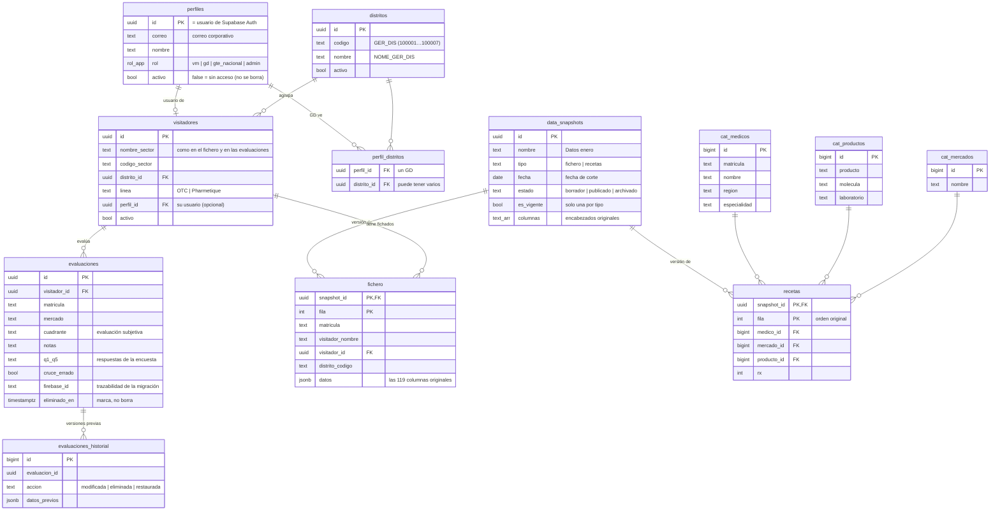

# Esquema de la base de datos (Supabase) — PROPUESTA

> **Estado: aprobado el 28/10/2026.** Migraciones 1 a 7 aplicadas en el
> Supabase de pruebas. La migración 8 (orden por mercado precalculado)
> falta aplicarla.

## Resumen en 6 puntos

1. **Cuatro roles:** `vm`, `gd`, `gte_nacional` y `admin`. Cada persona ve solo
   lo que le toca, y lo controla **la base de datos** (no el navegador).
2. **VM y GD se agregan, mueven o desactivan desde tablas** (sin tocar código).
   Un GD puede tener uno o varios distritos (y por lo tanto varios VM), pero
   **cada distrito tiene un solo GD**, así que **cada VM tiene un solo GD**.
3. **Los datos tienen versiones.** Cada carga de fichero o de recetas es una
   versión nueva ("Datos enero", "Datos noviembre"…). Solo una por tipo es la
   **vigente** ("Hoy"); las demás se pueden consultar. Una versión nueva **no
   se ve hasta que el admin la publica**, y se puede volver a una anterior.
4. **Nada se borra.** Ni siquiera el admin puede borrar filas. "Eliminar" una
   evaluación la **marca** como eliminada y guarda una copia en el historial;
   se puede deshacer.
5. **La configuración es compartida:** ponderación de la encuesta, umbrales y
   productos PHQ quedan en la base y valen igual para todos (hoy cada navegador
   tiene la suya).
6. **"Datos enero" se guarda intacto.** Se probó con los datos reales: las
   231.729 filas de recetas se reconstruyen **con 0 diferencias**, y el fichero
   conserva sus 119 columnas.

---

## Diagrama



Además hay dos tablas sueltas:
- `configuracion`: ponderación, umbrales, productos PHQ y equipos OTC.
- `app_errores`: el registro de fallas de la Fase 2.

---

## Quién ve qué (seguridad por fila, RLS)

| Tabla | `vm` | `gd` | `gte_nacional` | `admin` | Sin sesión |
|---|---|---|---|---|---|
| **Evaluaciones** | Ve y edita **solo las suyas** | Ve las de **su distrito** | Ve **todas** | Ve y edita **todas** | ❌ |
| Eliminar evaluación | ❌ | ❌ | ❌ | Solo **marcar** (con historial) | ❌ |
| **Fichero** (datos del médico) | Sus médicos | Médicos de su distrito | Todo | Todo | ❌ |
| **Recetas** | De sus médicos | De su distrito | Todas | Todas | ❌ |
| Versiones en **borrador** | ❌ | ❌ | ❌ | ✅ | ❌ |
| Publicar / volver a una versión | ❌ | ❌ | ❌ | ✅ | ❌ |
| Visitadores, distritos, usuarios | Solo el suyo | Los de su distrito | Ve todos | Ve y edita todos | ❌ |
| Configuración | Lee | Lee | Lee | Lee y edita | ❌ |
| Registro de fallas | Reporta | Reporta | Reporta y lee | Reporta y lee | Solo reporta |

Reglas adicionales:
- **Nadie puede borrar filas**, ni siquiera el admin: no existe ninguna regla
  que lo permita.
- **Usuario desactivado** (`activo = false`): no ve nada, pero sus datos se
  conservan.
- **Quien se registre por su cuenta** queda **inactivo** hasta que el admin le
  asigne un rol. Además, el registro abierto se apaga en Supabase.
- Las **cifras nacionales de mercado** (la etiqueta A+/B/C- de cada médico en
  cada mercado, que necesita las recetas de todo el país) se calculan **en el
  servidor** (Fase 7, función `datos_equipo`). Cada VM o GD recibe solo sus
  médicos y esos totales, nunca las filas ajenas.

**Probado:** 25 pruebas automáticas en un Postgres 16 real demuestran cada fila
de esta tabla (`tests/db/seguridad-por-rol.test.js`). Entre ellas: que un GD
**no** ve los datos de otro GD, que el Gerente Nacional **no** puede editar
nada, y que ni el admin puede borrar.

---

## Preguntas frecuentes

**Si nada se borra, ¿no se generan duplicados?** No:
- Una evaluación "eliminada" queda **marcada** (`eliminado_en`). Los VM, los GD,
  los reportes y las exportaciones **no la ven ni la cuentan**. Solo el admin y
  el Gerente Nacional la pueden consultar, como historial.
- La regla "una evaluación por visitador + médico + mercado" aplica **solo a
  las activas**. Si se elimina una por error y se vuelve a hacer, la nueva es
  la que cuenta y la vieja queda en el historial. Nunca hay dos activas.
- Si alguna vez hiciera falta borrar de verdad (por ejemplo, por una solicitud
  legal), se haría con un procedimiento explícito del admin, no desde la app.

## Versiones de datos ("Hoy" y anteriores)

```
Carga nueva ──► BORRADOR ──(admin revisa y compara)──► PUBLICADO + VIGENTE ("Hoy")
                                                          │
           la versión anterior queda PUBLICADA (consultable) ◄┘
           "Volver a una versión" = publicar de nuevo la anterior
```

- En la app hay un **selector de versión** (botón "Datos: Hoy" arriba):
  "Hoy" (la vigente) por defecto, y la lista de las anteriores publicadas.
  Los borradores solo los ve el admin, en el panel de carga.
- Cada versión guarda además su **archivo comprimido** en un almacén
  **privado** de Supabase (`datos`). La app lo descarga solo con sesión
  iniciada, mediante un enlace que vence en 1 hora (Fase 5). Desde la Fase 7
  ese archivo completo solo lo descargan el admin y el Gerente Nacional; los VM
  y GD reciben únicamente sus médicos con `datos_equipo` (pocos KB).
- Los **datos actuales** se migrarán (Fase 4) como **"Datos enero"**, una
  versión de fichero y otra de recetas, intactas.
- Fichero y recetas tienen versiones **independientes**: se puede actualizar
  uno sin el otro.
- **Qué médicos ve cada VM o GD** se decide con el fichero **vigente**: si un
  médico cambia de visitador, el cambio aplica desde que se publica el fichero
  nuevo.

## Espacio y costo

Medido con los datos reales en Postgres:

| Contenido | Espacio |
|---|---|
| Recetas "Datos enero" (231.729 filas + índices) | ≈ 34 MB |
| Catálogos de médicos y productos (se comparten entre versiones) | ≈ 12 MB |
| Fichero "Datos enero" (7.308 filas con las 119 columnas) | ≈ 19 MB |
| **Primera versión completa** | **≈ 65 MB** |
| Cada mes adicional (recetas + fichero) | ≈ 55 MB |

- **Plan gratuito de Supabase (500 MB):** alcanza para unas **7 a 8 versiones
  mensuales completas**.
- Después hay dos caminos (lo decides tú más adelante):
  - (a) archivar versiones viejas en un archivo descargable;
  - (b) pasar al plan **Pro (25 USD/mes, 8 GB)**.
- Para ahorrar espacio, médicos, productos y mercados se guardan una sola vez
  en catálogos, y cada fila de recetas apunta a ellos. Cada combinación se
  guarda **tal cual vino** (no se "corrige" nada), por eso la reconstrucción
  da 0 diferencias.

---

## Archivos

| Archivo | Contenido |
|---|---|
| `supabase/migrations/20261028120000_roles_y_equipos.sql` | Roles, distritos, perfiles, visitadores, funciones de permisos |
| `supabase/migrations/20261028120100_datos_versionados.sql` | Versiones, catálogos, recetas, fichero, publicar versión |
| `supabase/migrations/20261028120200_evaluaciones_y_config.sql` | Evaluaciones, historial, configuración compartida (con los valores actuales), registro de fallas |
| `supabase/migrations/20261028120300_seguridad_rls.sql` | Todas las reglas de seguridad por fila |
| `supabase/migrations/20261028130000_un_gd_por_distrito.sql` | Regla: cada distrito tiene un solo GD |
| `supabase/migrations/20261029120000_carga_de_datos.sql` | Fase 5: archivo de cada versión, almacén privado `datos`, carga por lotes, comparar versiones |
| `supabase/migrations/20261030120000_datos_por_equipo.sql` | Fase 7: `datos_equipo` (cada VM/GD recibe solo lo suyo) y archivo completo solo para admin y Gte. Nacional |
| `supabase/migrations/20261030130000_orden_mercado.sql` | Arreglo Fase 7: orden nacional por mercado precalculado una vez por versión (`recetas_orden_mercado`) |
| `supabase/rollback/…` | Archivos para **deshacer**. **No se aplican** salvo que haya que revertir algo |
| `tests/db/` | Pruebas: permisos por rol y "Datos enero" sin pérdidas |

Todas las migraciones son **aditivas**: solo crean cosas nuevas y no tocan
Firebase ni la app actual.

---

## Cómo se aplica (DESPUÉS de tu aprobación, en el Supabase de PRUEBAS)

1. Abre https://supabase.com/dashboard → proyecto **segmentapp-pruebas**.
2. Menú izquierdo → **SQL Editor** → **New query**.
3. Abre en GitHub el primer archivo de `supabase/migrations/` (el que termina
   en `120000_roles_y_equipos.sql`) → ícono **copiar** → pégalo en el editor
   → **Run**. Debe decir *Success. No rows returned*.
4. Repite con los otros 3 archivos, **en orden** (120100, 120200, 120300).
5. **Table Editor**: deben aparecer las tablas `perfiles`, `evaluaciones`,
   `data_snapshots`, etc.
6. **Authentication → Sign In / Providers**: desactiva **"Allow new users to
   sign up"** (nadie puede registrarse por su cuenta).

Si un paso falla, cópiame el mensaje de error (no contiene secretos).
